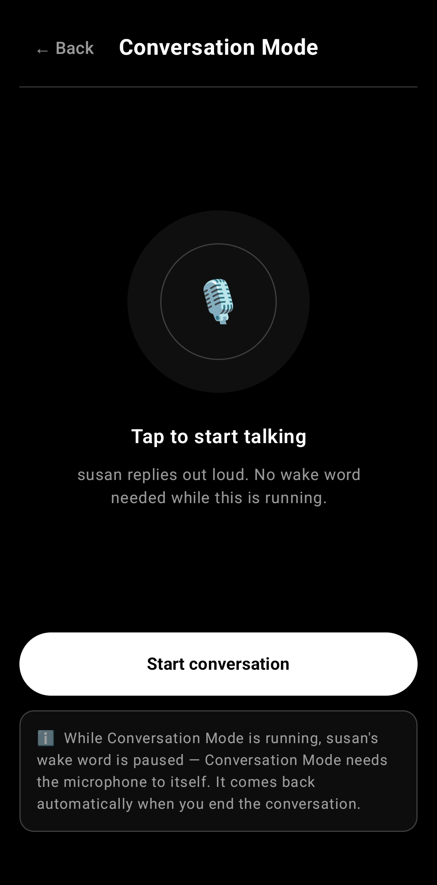
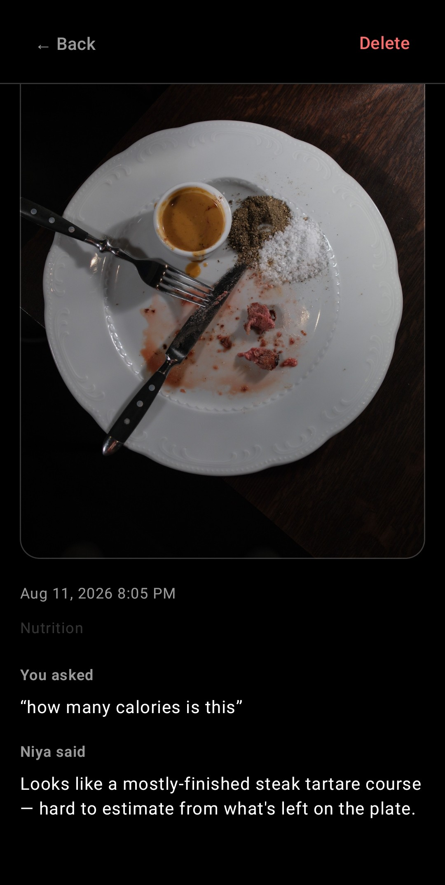
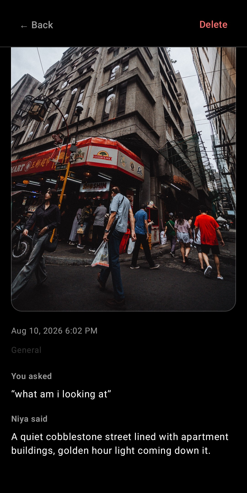
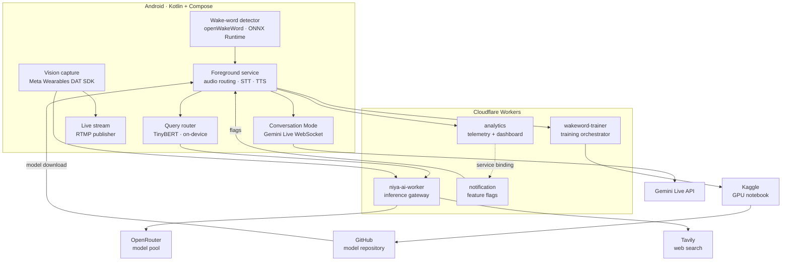

# NIYA

**Natively, it's your assistant.**

Say the word with the phone in your pocket and the screen dark. That one interaction shapes everything else in the build. An openWakeWord model runs continuously on-device over 16 kHz mono capture, a TinyBERT classifier decides locally whether a question needs a fast model, a live search or a reasoning model, and every provider key sits in a Cloudflare Worker instead of the APK. Connect a pair of Ray-Ban Meta glasses and it can also look at whatever you point them at.

  
  
  

**Download:** [Niya v1.0.0 (APK)](https://github.com/NativelyItsYourAssistant/niya/releases/download/V1.0.0/Niya.v1.0.0.apk) · **Wake-word models:** [Niyawakeword/niya-wakeword-models](https://github.com/Niyawakeword/niya-wakeword-models)

---

## What it does

**It listens with the screen off.** A foreground service holds a three-stage ONNX pipeline over 16 kHz capture. Nothing is uploaded until a wake word has fired, so the first moment audio leaves the phone is the moment you asked for something.

**It learns phrases you type.** Settings takes arbitrary text, a Worker patches a Kaggle notebook, and about 27 minutes of GPU time later an ONNX model appears in a public GitHub repository and installs without an APK update. Five hundred synthetic clips across nine voices, augmented, with two thousand LibriSpeech recordings as hard negatives.

**It decides before it dials.** The router returns LOCAL, API_SIMPLE, API_REALTIME or API_COMPLEX on-device, and that label is final. There is no second pass and no cloud round trip to revise it.

**Conversation Mode** trades the wake word for an open Gemini Live session, full duplex over a WebSocket, until you say the stop phrase.

**Vision** through the glasses, in three prompt modes: general, nutrition, and read/OCR. Each answer is stored with its photo in a gallery you can search later.

**Live streaming** publishes the glasses camera over RTMP to any ingest endpoint. It needs the hardware, and the UI says so before the first frame rather than failing after it.

**Reminders** are parsed server-side into a message and a trigger time, then scheduled with an exact alarm that survives a reboot.

---

## Architecture

None of that split is a preference for server-side code. Two constraints forced it. An APK that ships an OpenRouter key ships it to everyone who installs the app, and a wake word cannot wait for a round trip. Everything else followed from where those two boundaries landed.

The practical effect: model choices, prompt rules and search behaviour change in a Worker deploy, which costs less than a release and reaches users who never update anything.

---

## Read more

| Document | What's in it |
|---|---|
| **[Platform resistance](docs/platform-resistance.md)** | The centerpiece. What Android and the OEM audio stacks do to an always-on assistant, how each failure presents from inside the app, and what it costs the user. |
| [Architecture](docs/architecture.md) | Every component, why the split falls where it does, and the full technology inventory. |
| [The voice pipeline](docs/voice-pipeline.md) | Wake word through routing to speech, plus the microphone handoff that keeps two `AudioRecord`s from killing each other. |
| [Custom wake words](docs/wakeword-pipeline.md) | TTS data generation, augmentation, hard negatives, the score-on-silence retry loop, and the Worker that drives Kaggle. |
| [Vision](docs/vision.md) | Glasses capture through the DAT SDK, the three prompt modes, and why the model is told to ignore the photo. |
| [Backend](docs/backend.md) | Four Workers, their routes and bindings, key rotation, and the privacy model for telemetry. |

---

## A few things that turned out to be harder than they look

Opening a second `AudioRecord` while the first is live succeeds on some OEM audio stacks and then delivers zeros forever. There is no error and no callback, and the only way to tell it apart from a quiet room is downstream, in whether the mel stage ever produced a frame. Every microphone handoff in the app exists because of that.

The built-in microphone is not reliably available to a background process at all. The workaround is routing through SCO/HFP, which the platform classifies as telephony input and arbitrates differently from room capture. A phone call that never ends, in effect.

openWakeWord will learn that silence means yes. A model trained on speech against noise can converge on energy instead of the phrase, score 0.9 on a silent clip, and fire all night in a bedroom. Training loss never shows it, so the pipeline scores every candidate on silence and retrains if it fires.

Worker-to-Worker `fetch()` is rejected with error 1042. It needs a Service Binding, and there is nothing to tune around it.

Spoken queries make poor search queries. "How's the weather" carries no place and no date, so a cheap model rewrites it before Tavily sees it, and the rewrite comes back to the client so a wrong answer can be traced to the query that produced it.

---

## What's public and what isn't

The app source is private. This repository documents how it works rather than reproducing it. The APK in Releases is a signed, R8-minified release build. The wake-word model repository, the trained artifacts and the website are public and checkable.

---

## Status

v1.0.0 released. Android 10+ (`minSdk` 29, `targetSdk` 36). Glasses features need Ray-Ban Meta hardware; everything else works without it.

## Licence

All rights reserved. The documentation here may be read and linked to; the application, its models and its name may not be redistributed or reused without permission.
