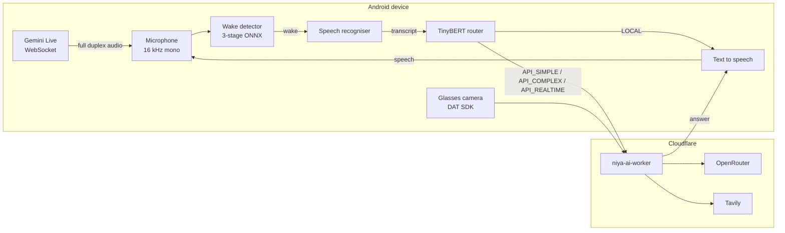
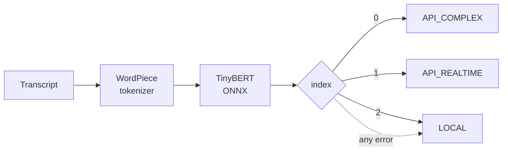

# Architecture

One line divides NIYA: what has to happen on the device, and what is better done off it. Capture, wake detection, query routing and speech stay on the phone. Model choice, prompts, web search, provider keys and reasoning live in a Cloudflare Worker.

That split is not a taste for server-side code. Four constraints forced it, and each one picked a side:

| Constraint | Consequence |
|---|---|
| Wake-word detection must work offline and must not stream audio | Runs entirely on-device, in ONNX Runtime |
| Provider keys can't be shipped in an APK | All inference is proxied through a Worker |
| Model choice and prompt rules change faster than an app release | They live in server code, not in the build |
| Routing has to be immediate and has no cloud round-trip budget | TinyBERT classifier runs on-device |

---

## On the device

### Single-activity Compose UI

One `Activity`, no Navigation component. `currentScreen` is a string field, screen changes are assignments, and the screens are Compose functions selected by a `when`. Every screen in this app is a settings or gallery surface reached from one of four entry points, and a navigation graph would have been larger than the router it replaced.

The architectural fact about the UI is how little state it owns. The wake-word detector, the audio route, the recogniser, the TTS engine, the glasses connection and any pending training job all live in the foreground service. The UI observes and sends intents. That is why the service survives rotation, backgrounding, and the Activity being killed under memory pressure.

### Foreground service

The service is the application. It starts once, generally right after onboarding, and is expected to outlive every Activity for the life of the installation. It owns:

- the wake-word detector and its rebuild lifecycle;
- Bluetooth connection state, via ACL broadcasts;
- the audio routing state machine (see [platform resistance](platform-resistance.md));
- background speech recognition and text-to-speech;
- the pending wake-word training job, polled every five minutes;
- install and heartbeat telemetry;
- conversation-mode session state.

It declares `FOREGROUND_SERVICE_MICROPHONE` and `FOREGROUND_SERVICE_CONNECTED_DEVICE`. Microphone covers capture, connected-device covers the Bluetooth route. Losing foreground status means losing the microphone, so the notification is functional instead of decorative.

### Wake-word detector

A three-stage openWakeWord pipeline in ONNX Runtime: mel-spectrogram, then a shared embedding, then a per-keyword classifier. 16 kHz mono, 1,280-sample chunks, a sixteen-embedding rolling window, a new embedding every 8 mel frames. Threshold 0.85, cooldown 3 seconds.

It classifies a rolling window rather than an utterance, and that distinction drives most of the detector's design. It gets its own section in [platform resistance](platform-resistance.md#5-rolling-window-classifiers-need-the-quiet-parts).

Custom models land in `filesDir/wakeword/`, and the service sends `ACTION_REBUILD_DETECTOR` to swap them without restarting the process.

### Query router

A TinyBERT model fine-tuned as a three-class classifier, exported to ONNX and run on-device. It answers one question: does this query need the phone at all?

The index mapping comes from `LabelEncoder`'s alphabetical sort (COMPLEX, REALTIME, SIMPLE), and the code states that rather than trusting it silently. `LOCAL` is the error default because the local path is rule-based and catches most queries anyway. A classifier failure should cost quality, never money.

Tokenization is a hand-rolled WordPiece implementation: greedy longest-match, `##` continuation, vocabulary file. No tokenizer dependency, no JNI, no Python at runtime. Tensor names are read from the loaded model instead of hardcoded, so a re-export under different names can't silently feed the wrong input.

### Conversation mode

Full duplex against the Gemini Live API over a WebSocket, 16 kHz PCM up and 24 kHz PCM out, both mono 16-bit, both through the app's own `AudioRecord` and `AudioTrack`.

The wake-word detector is stopped while a session runs, not paused. Two `AudioRecord` instances do not coexist reliably on every OEM stack and the failure is silent, so the controller enforces the rule as an invariant: `start()` releases the detector before connecting, `stop()` restores it after disconnecting. No code path opens both.

Backgrounding a live session hot-swaps the local audio route to SCO without touching the WebSocket. With no headset, the session ends, because no other capture path survives backgrounding.

### Vision and glasses

The glasses are reached through the Meta Wearables Device Access Toolkit. A still capture is: open a stream session, await the first video frame with a timeout, convert to bitmap, close the session in a `finally`. That `finally` carries weight. An orphaned session keeps the glasses capturing, which lights the LED and drains the battery, and the user has no fix beyond disconnecting the hardware.

Images are downscaled on the phone before upload. Long edge 1024 for general and nutrition, 1536 for OCR, JPEG at quality 80. Re-encoding costs a few milliseconds and saves hundreds of kilobytes over mobile data, and OCR is the one mode where the extra resolution earns its cost.

Live streaming is RTMP through RootEncoder, behind a `LiveStreamPublisher` interface, because the library's 2.4 line renamed its callback interface and changed the `sendVideo` signature. The interface is a seam that absorbed a breaking upgrade, not an abstraction for its own sake. Frames come only from the DAT camera, so streaming needs the glasses.

### Storage

Preferences in `SharedPreferences`. Conversation and vision history in local files with a small index. Sessions survive process death: a reminder set for tomorrow is an `AlarmManager` exact alarm with a `BOOT_COMPLETED` re-registration, not a coroutine that dies with the process.

---

## On the edge

Four Workers, each with a different job and a different blast radius:

| Worker | Job | Public? |
|---|---|---|
| `niya-ai-worker` | all inference, vision, search, reminders, greetings | yes |
| `niya-analytics-worker` | telemetry intake + private dashboard + flag portal | intake only |
| `notification-worker` | feature flags the app reads on start | read-only |
| `wakeword-trainer-worker` | Kaggle training orchestration | no |

The gateway is a single POST endpoint where a `route` field selects behaviour, and every route returns JSON with an `answer` field. One parser on the client no matter which model or tool produced the text. The routes are `API_SIMPLE`, `API_COMPLEX`, `API_REALTIME`, `API_VISION`, `API_REMINDER`, `API_REMINDER_DELETE`, `API_GREETING`, `API_SUMMARIZE`.

Detail is in [backend](backend.md).

---

## Build shape

Kotlin and Jetpack Compose, single module. `minSdk 29`, forced by the `mwdat-camera` manifest, which drops Android 9 and below. `targetSdk 36` and `compileSdk 36`.

Release builds run R8 with resource shrinking. Dependencies: ONNX Runtime 1.20.0, OkHttp 4.12.0, Gson 2.11.0.

The three Meta SDK artifacts (`mwdat-core`, `mwdat-camera`, `mwdat-mockdevice`) have to stay version-pinned together. Resolving one of them newer than the others produces a `NoSuchMethodError` at connect time rather than a build failure, which is a much worse place to find out.

`packagingOptions` `pickFirst` handles `libonnxruntime.so` and `libonnxruntime4j_jni.so`, since transitive dependencies ship duplicates of both.

The SDK resolves from GitHub Packages and needs a token in `local.properties`. A clean checkout therefore won't build without credentials, which is also why the APK is the distribution artifact rather than the source.

---

## Why not put the wake word in the cloud

It would mean streaming audio from every phone, continuously, on the chance that someone says the word. Stated plainly, nobody would accept the privacy posture, and nobody would accept the bandwidth bill either. A three-stage ONNX model on a phone costs almost nothing to run. The expensive part is training, which happens once per wake word, offline, on a GPU.

Everything after the wake word is a request the user deliberately made, and sending that to a server is defensible. Everything before it is not.
