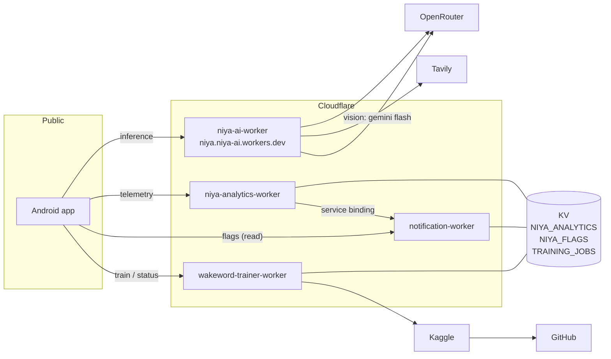

# Backend

Four Cloudflare Workers. Three exist because the phone can't be trusted with something, and one exists because Kaggle can't call the phone.



---

## `niya-ai-worker`: the inference gateway

One POST endpoint, with a `route` field selecting behaviour. Every route returns JSON containing an `answer` string, so the client has exactly one parser and one failure path.

| Route | Job | Model |
|---|---|---|
| `API_SIMPLE` | ordinary questions, with an optional search gate | fast |
| `API_COMPLEX` | reasoning, maths, comparisons; no search | reasoning |
| `API_REALTIME` | time-sensitive questions, search first | fast + Tavily |
| `API_VISION` | glasses images in three modes | vision list |
| `API_REMINDER` | transcript → `{ message, triggerMs }` | fast |
| `API_REMINDER_DELETE` | which reminder to cancel | fast |
| `API_GREETING` | time-and-place aware greeting | fast |
| `API_SUMMARIZE` | conversation summaries | fast |

### Being a voice API

Every design decision in this Worker starts from the caller being a speaker, not a screen.

**Errors are HTTP 200.** A 5xx reaches the user as silence or a crash line. A 200 carrying "Sorry, I had trouble reaching the server" reaches them as an apology. The real cause goes to `console.error`, where someone can actually read it. The rule holds all the way to the top-level catch-all.

**Prompts forbid markdown.** No bullets, no headings, no emphasis. A model that emits `**bold**` gets spoken as "asterisk asterisk bold".

**Answers stay short, by prompt and by `max_tokens`.** The ceiling is not there to trim good answers. It is there to stop a rambling one, which costs a listener more than a truncated reply does.

**Time and place are injected, and the model is told not to mention them.** `request.cf` gives the Worker city, region, country and timezone at the edge, so the assistant knows where it is without the app holding a location permission. The prompt supplies `localTime` formatted in the user's timezone and then says explicitly not to bring it up unprompted. Without that, every answer opens with "As of 6:22 PM in Bangalore…".

```js
const city      = request.cf?.city     ?? "your location";
const timezone  = request.cf?.timezone ?? "UTC";
const localTime = new Date().toLocaleString("en-US", {
  timeZone: timezone, weekday: "long", year: "numeric",
  month: "long", day: "numeric", hour: "2-digit",
  minute: "2-digit", timeZoneName: "short"
});
```

### Key rotation

Provider keys live in a comma-separated secret and are shuffled per request, with retries only on `429`:

```js
const keys     = env.OPENROUTER_API_KEY.split(",").map(k => k.trim()).filter(Boolean);
const shuffled = [...keys].sort(() => Math.random() - 0.5);
```

Retrying only on rate limits matters. A 429 is another key's problem. A 400 or a malformed response is the payload's problem, and retrying it across the whole pool multiplies the cost without changing the outcome. When every key is exhausted the Worker throws, and the route's own handler turns that into something speakable.

### Spoken queries are bad search queries

"How's the weather" has no place and no date in it. Before Tavily sees a query, a cheap model rewrites it into something a search engine can use. The rewrite comes back to the client alongside the answer as `searchQuery`, so a wrong answer can be traced to the query that produced it.

### Search gating, in both directions

`API_SIMPLE` and `API_REALTIME` pull in opposite directions:

| Route | Gate first? | `max_results` | On gate failure |
|---|---|---|---|
| `API_SIMPLE` | no: search is the exception | 5 | falls through to the model |
| `API_REALTIME` | yes: search is the expected path | 10 | short-circuits to reasoning |

The gate fails open. If the classification call errors, search runs. A needless search costs a slower answer; a skipped search costs a confidently wrong answer about today's weather. Those are not equal.

`API_REALTIME` synthesises across results with a strict prompt: answer only from the results, never invent dates, prices or scores, say so when something isn't there. It returns `sources` so a live claim can be checked.

### Reminders do arithmetic server-side

Language models are unreliable at 13-digit epoch maths. The reminder prompt pre-computes trigger times for the common relative phrasings ("in ten minutes", "tomorrow at eight") and embeds them as literals. The model pattern-matches the phrasing; it does no arithmetic.

The device then schedules an exact alarm and re-registers it on boot, so a reminder set for tomorrow survives a reboot and a dead process.

---

## `niya-analytics-worker`: telemetry, dashboard, flag portal

Three jobs in one Worker, because they share a KV namespace and none of them justifies its own deployment.

**Telemetry intake** (`POST /ping`) is public. Each device generates its own identifier client-side, and that is the entire privacy design. The Worker never stores an IP, and a pseudonymous identifier it did not generate cannot be correlated with a person by the Worker. Country comes from edge metadata rather than from anything the client sent. What results is a device count and a coarse geographic distribution, which is all it was ever for.

**Dashboard** (`GET /dashboard`, `GET /dashboard/data`) is password-protected. **Flag portal** (`GET/POST /portal/flags`) is password-protected and proxies to the notification Worker.

### The service binding requirement

```js
const res = await env.FLAGS_SERVICE.fetch("https://flags-internal/flags");
```

That line is not an optimisation. A plain `fetch()` to another `*.workers.dev` hostname is rejected by Cloudflare with error 1042. A Worker cannot call itself over the public edge, and another Worker's `workers.dev` hostname falls into the same origin class. The Service Binding is the supported route and a hard requirement.

The Worker makes the failure diagnosable. A missing binding returns a 500 that names the binding, and the dashboard reports `hasFlagsService`, `hasFlagsAdminKey`, `hasPortalPass` and `hasDashboardPass` as booleans. That last one exists because the two most common setup failures, a missing binding and a wrong admin key, produce very similar symptoms.

### The password fallback

```js
const DASHBOARD_PASSWORD =  DASHBOARD_PASS;
const expected = env.DASHBOARD_PASS ?? DASHBOARD_PASSWORD;
```

Resolution order runs `PORTAL_PASS`, then `DASHBOARD_PASS`, then the compiled-in default, so a deployment that sets only one variable still works. The fallback is convenient for a single-operator deployment and a liability everywhere else. The file says as much, and changing it is the first thing to do before deploying.

### Dashboard auth is a bearer check

No session, no cookie. The dashboard URL carries the password and the data endpoint checks it. That is proportionate for a personal analytics page and wrong for anything shared, which is why it was not reused for anything else.

---

## `notification-worker`: remote feature flags

Five KV keys, read concurrently:

```js
const [show_notice, notice_text, show_cta_button, cta_url, cta_label] =
  await Promise.all([ /* five concurrent KV reads */ ]);
```

The app reads them on start and can show a banner with a call to action without a new APK. A notice about a broken model, a migration, a discontinued backend: anything that would otherwise require a release.

The admin endpoint (`POST /admin/flags`) is guarded by an `X-Admin-Key` header and an allow-list:

```js
const allowed = ["show_notice","notice_text","show_cta_button","cta_url","cta_label"];
```

The allow-list matters because writes are partial. Without it, a typo'd key silently creates a KV entry nothing reads, and an arbitrary payload can inject keys into the namespace.

Reads are public and writes are keyed, which is the right shape for a flag service, since flags are by definition content meant to be shown to users.

---

## `wakeword-trainer-worker`: training orchestration

The only Worker that doesn't serve the app at runtime. It serves onboarding. Coverage is in [custom wake words](wakeword-pipeline.md).

Its shape: `POST /request-model` validates and slugifies the phrase, checks GitHub for a cached model, and otherwise patches the Kaggle notebook and pushes a new version. `GET /status` polls GitHub for the artifact. `POST /cancel` drops a pending job. Failures land in KV under `failure:<timestamp>:<slug>`.

`TRAINING_TIMEOUT_MS` is 35 minutes, taken from the gap between observed successful runs (18:50 to 32:01) and failures (36:08 to 42:15). It wasn't rounded to anything.

---

## Secrets inventory

| Secret | Where | What |
|---|---|---|
| `OPENROUTER_API_KEY` | gateway | comma-separated pool |
| `TAVILY_API_KEY` | gateway | comma-separated pool |
| `ADMIN_KEY` | gateway | admin routes |
| `FLAGS_ADMIN_KEY` | notification + analytics | flag writes |
| `PORTAL_PASS` / `DASHBOARD_PASS` | analytics | dashboard access |
| `KAGGLE_ACCOUNTS` | trainer | Kaggle credentials |
| `GITHUB_TOKEN` | trainer | model repo writes |
| `VISION_MODEL` | gateway | optional model override |

None of these ship in the APK. That is the reason the gateway exists at all. An app that ships an OpenRouter key ships it to everyone who installs the app.

---

## What KV can and can't do

KV is eventually consistent, has no atomic counters, and is not a database. The analytics Worker does read-modify-write on `stat:total_installs`, which can lose an increment when writes overlap.

That is accepted, for a reason worth stating. The number is a growth indicator, not a billing figure. Making it exact would mean a Durable Object per counter, which is a great deal of machinery and latency for a figure nobody makes decisions on. Where exactness does matter (whether a device has been counted, whether a model exists), the Worker uses write-once keys and reads the artifact itself, and those are correct under KV's guarantees.

---

## Why this shape

Four small Workers rather than one, because they have different blast radii:

- the gateway is public and hot and must never be coupled to telemetry writes;
- the analytics dashboard holds a password and should not share a deployment with anything the app calls;
- the flag service has to stay up when everything else is down;
- the trainer is a one-shot job runner that can scale to zero and break without anyone noticing.

The cost is four deployments and a Service Binding. The benefit is that a mistake in one doesn't take down the assistant.
