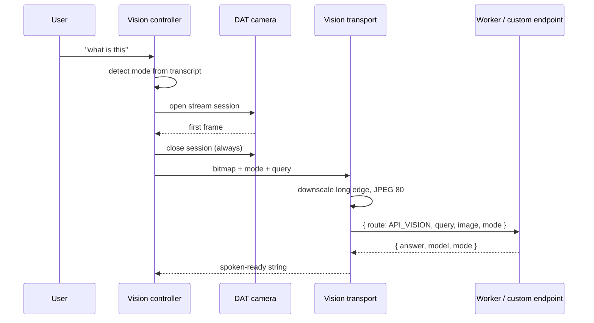
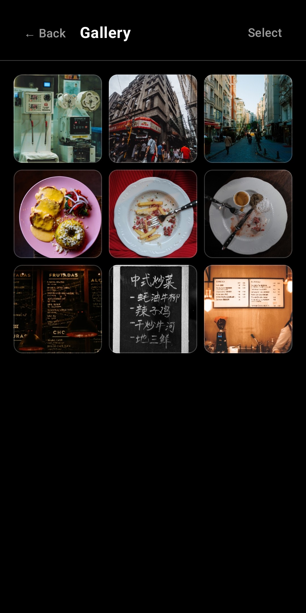

# Vision

Point the glasses at something, ask a question out loud, hear an answer. Three prompt modes, two providers, one transport.

---

## Capture

The glasses are reached through the Meta Wearables Device Access Toolkit. A still image is a video stream session from which one frame is taken: open a session, await the first frame with a timeout, convert to a bitmap, close the session in a `finally`.

That `finally` earns its place. An orphaned session leaves the glasses capturing, which lights the capture LED, drains the battery, and leaves the user with no remedy short of disconnecting the hardware. Every error path closes the session.

Live streaming uses the same source with the session held open, publishing frames over RTMP. Since the DAT camera is the only frame source, live streaming cannot work without glasses. The UI says that up front rather than discovering it at the first frame.

## Downscaling

Before the image goes anywhere, the long edge is capped and the result encoded at JPEG quality 80.

| Mode | Long edge |
|---|---|
| General | 1024 |
| Nutrition | 1024 |
| Read (OCR) | 1536 |

This is the largest latency lever in the vision path and the one the app controls directly. Upload time over mobile data and vision-token prefill at the model both scale with pixel count, and a full-size frame carries far more than "what is this" needs.

OCR is the exception, because small print survives aggressive downscaling badly. The two caps are separate constants so that if OCR proves unreadable, the read cap can rise alone without every other mode paying for it.

## Providers

The transport layer is the only place that knows how a request travels, and its caller never learns which path ran.

**NIYA_DEFAULT** posts to the Worker with `route: "API_VISION"` and `{ query, image, mode }`. The Worker owns the system prompt, including per-mode variants and the relevance rule. The phone sends a transcript and a mode string, and no instructions to the model.

**CUSTOM** sends a standard OpenAI-compatible `/chat/completions` request to the user's own endpoint. There is no Worker on this path, so the prompt is built locally. Same modes, same rules, different owner.

Preferences are re-read on every call, so changing the endpoint or the key takes effect on the next request without a restart.

## The three modes

Mode selection is lexical. The transcript is matched against per-mode pattern sets with anchored and anywhere forms, in priority order: nutrition, then read, then general.

| Mode | What changes |
|---|---|
| **general** | Describe what's in frame and answer the question. `max_tokens` 150. |
| **nutrition** | Estimation is explicitly encouraged. A calorie count from a photo is a guess, and a refusal to guess is less useful than a labelled guess. `max_tokens` 220. |
| **read** | OCR. Guessing is explicitly forbidden; if the text is illegible, say so. `max_tokens` 220. |

Nutrition and read ask opposite epistemic behaviour from the same model. General sits between them.

### The relevance rule

All three modes share one rule, and it does the most work:

> If the question isn't about the image, ignore the image completely and answer normally.

Without it every vision request becomes a vision problem. Point the glasses at a wall, ask what the capital of France is, and the model answers about the wall, because it was handed an image and a question and assumed they belonged together. With the rule, one code path handles both "what is this" and "what's the weather", and the user never has to know which mode they are in.

### Output rules

Shared across modes:

- No markdown.
- No "in the image" preamble.
- At most three short sentences.

Speech constraints, not style preferences. Markdown gets read aloud as punctuation, "in the image, I can see" wastes the first second of every reply, and a paragraph is not an answer to a question asked out loud.

## Failure policy

The vision route never returns a non-200 for a vision problem. The caller is a voice assistant mid-conversation, and an HTTP error reaches the user as silence.

| Failure | Response |
|---|---|
| No image | "I couldn't get a picture from your glasses…" |
| Image over 10 MB | "That photo was too large…" |
| All models failed | "I couldn't make out what you're looking at just now." |
| Unknown mode | degraded to `general`, answered normally |

Every one of those returns HTTP 200 with a speakable `answer` and an `error` field for logging. The `error` field keeps the failure diagnosable without making it the user's problem.

An unknown `mode` from an older client degrades instead of erroring, so a client that is behind still gets useful answers.

## Model selection

Vision uses a shorter list than the text routes, drawn from different models:

| Model | Why |
|---|---|
| `google/gemini-2.5-flash-lite` | primary, measured ~3 s |
| `google/gemini-2.0-flash-001` | fallback |
| `qwen/qwen3.7-flash` | last resort, measured ~60 s on free tier |

The `VISION_MODEL` environment variable prepends to the list, so a model can be pinned without a deploy that changes anything else. Fallbacks exist because free-tier availability moves around; the list is documented as a fallback rather than a preference.

Image content precedes the text in the message, deliberately. Providers attend to a question in the context of an image that is already present with that ordering.

## The gallery

Every vision result is stored with its photo and its transcript, and the whole set is searchable. That is how the feature stays useful past the moment of asking. The answer to "what was that sign" from last week is still there.

