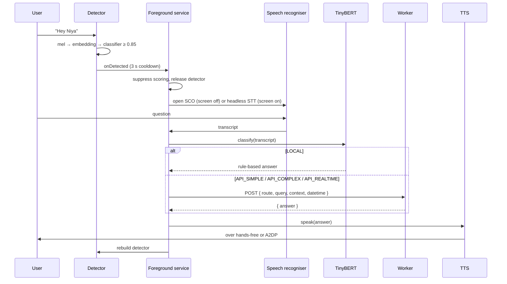

# The voice pipeline

Say the word, hear an answer, with the screen off, no app open and a Bluetooth headset in your ear. Everything hard about that journey happens at the seams between components.



---

## 1. Detection

The detector reads 16 kHz mono PCM in 1,280-sample chunks, eighty milliseconds at a time, and pushes each chunk through three stages:

| Stage | Input | Output |
|---|---|---|
| melspectrogram | raw PCM | 32-bin mel frames |
| embedding | 76 mel frames | 96-dim vector |
| classifier | 16 embeddings | score for this keyword |

A new embedding is computed every 8 mel frames, so one spoken keyword produces several overlapping embeddings and several classifier evaluations. The window needs sixteen embeddings before it scores at all. That detail matters later: gappy audio doesn't simply reduce accuracy, it stops scoring outright.

When the score crosses `0.85` and the three-second cooldown has elapsed, the detector fires on the main thread and is stopped immediately. Stopping it is not politeness. The recogniser is about to ask for the same microphone.

## 2. The microphone handoff

Almost all of the app's complexity lives here, because the failure is silent.

Two `AudioRecord` instances cannot be assumed to coexist. On some OEM audio stacks, opening a second one while the first is live succeeds and then returns silence forever. The detector doesn't raise anything. It stops hearing, and from inside the app that is indistinguishable from a quiet room.

The rule is absolute. Only one `AudioRecord` exists at a time, anywhere in the app. Ordering enforces it rather than locking:

1. Detector stops, releases, and is not rebuilt until step 5.
2. The recogniser opens. On the screen-off path, SCO has to come up first, which is a broadcast round trip rather than a call.
3. Recognition runs.
4. The answer is spoken.
5. The detector rebuilds on a clean HAL path.

One extra step appears on the A2DP route. After playback, the capture path can still be reserved (see [platform resistance](platform-resistance.md#2-after-playback-ends-the-capture-path-can-stay-reserved)). The app briefly presents a zero-pixel window to make the platform release the built-in microphone, then rebuilds.

Conversation mode applies the same rule at a larger scale. `start()` releases the detector, then connects and opens its own capture; `stop()` disconnects and restores the detector. No path opens both, and the detector is stopped rather than paused, because a paused detector still holds its handle.

## 3. Recognition

`SpeechRecognizer` with `LANGUAGE_MODEL_FREE_FORM`, one result, no partials.

The app used to play a listening tone of its own before starting recognition. It was removed because it sounded about 2.5 seconds before the microphone was actually open, which trained users to speak too early. The platform's own cue fires when capture truly starts, so it is the only honest signal, and dropping the app's cue took that latency out of the interaction.

On Android 13 and later, the screen-on path launches a headless Activity for recognition instead of binding the recogniser from the service. The Activity gives the recognition service the foreground context it expects without drawing anything.

The transcript then gets checked in order:

1. **Vision intent?** If the query is about what the user is looking at, and glasses are connected, it goes to the vision path. Classification happens before the hardware check, so "what is this" with no glasses still produces a sensible spoken answer.
2. **Conversation mode trigger?** A phrase from the user's own transcript, scanned against a configurable set of voice-stop and voice-start phrases.
3. **Reminder?** Parsed into message and trigger time, scheduled, confirmed aloud.
4. **Classify** with TinyBERT.

## 4. Routing

The classifier returns one label and the label is the decision. No second pass:

| Label | Meaning | Destination |
|---|---|---|
| `LOCAL` | rule-based, no network | answered on-device |
| `API_SIMPLE` | one fast model call | Worker → fast model |
| `API_COMPLEX` | reasoning, multi-step | Worker → reasoning model |
| `API_REALTIME` | needs current data | Worker → search + model |

`LOCAL` doubles as the failure default. If the model fails to load, the tokenizer throws, or the output shape is unexpected, the app answers locally instead of falling back to a paid call. A classifier problem should cost quality, not money.

The Worker receives the query along with everything it cannot infer:

```json
{
  "route": "API_SIMPLE",
  "query": "what's the weather like",
  "context": "...",
  "current_datetime": "2026-03-14 18:22",
  "timezone": "Asia/Kolkata",
  "lastAnswer": "...",
  "userName": "..."
}
```

`lastAnswer` is what makes follow-ups work without a conversation buffer. "What about tomorrow" resolves because the previous answer rides along. `current_datetime` and `timezone` are sent because a spoken query almost never contains them and the Worker has no other route to the user's local time.

The response contract is deliberately boring: `{ "answer": "..." }` on every route. One parser, one failure path.

## 5. Speech

`TextToSpeech`, initialised once in the service and kept alive. Engine initialisation is slow enough that doing it per utterance adds a noticeable pause before every reply.

Stream selection depends on state again:

| Situation | Stream |
|---|---|
| Screen off, headset | `STREAM_VOICE_CALL` over SCO |
| Screen on, headset | A2DP |
| Screen on, no headset | speaker |
| Live session | the session's own `AudioTrack` |

`STREAM_VOICE_CALL` is the stream the HAL routes through the hands-free link reliably. Music streams get rerouted to A2DP mid-utterance on some devices, which cuts the reply in half.

Replies arrive as plain text with no markdown, enforced by the Worker's prompts. A model that emits `**bold**` gets read aloud as "asterisk asterisk bold asterisk asterisk", and nobody wants that in their ear.

## 6. Failure behaviour

Every stage has a defined degraded state, and none of them are silent:

| Failure | Behaviour |
|---|---|
| Detector handle dead | in-place restart, then full rebuild, then stop trying |
| Recogniser fails to start | spoken apology, detector restored |
| Classifier throws | answered locally |
| Worker unreachable | spoken apology, 45 s read timeout |
| Worker returns non-JSON | parsed for `answer`, else apology |
| Worker returns 429 on every key | retried across the key pool, then apology |
| TTS engine missing | notification with the answer text |

The rule throughout: the user should hear something. A wake word followed by silence is indistinguishable from a broken app, and there is no screen to fall back on.
