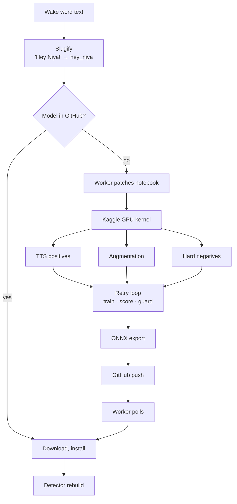
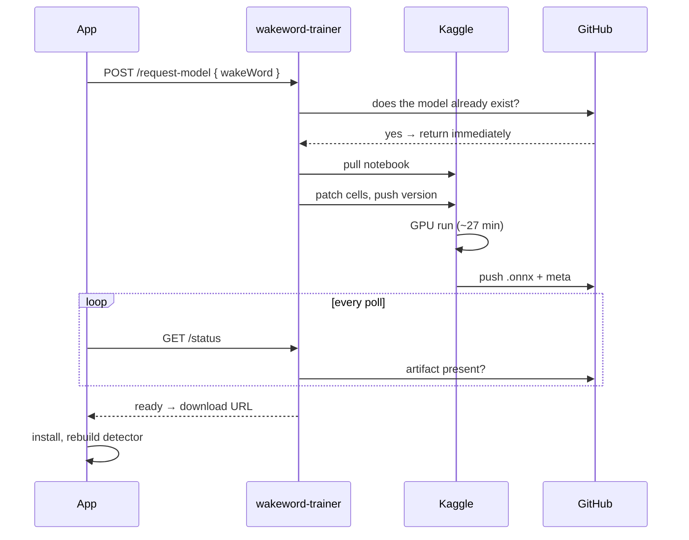

# Custom wake words

Type any phrase into settings and 27 minutes later it is the word you say. No app release, no retraining by hand, no Python on the device.

Training the model was never the difficult part. The difficult part was training one that stays quiet in an empty room.

---

## The pipeline



## Data generation

No recording exists of the user saying "Hey Niya", because the user has only just typed the phrase. Positives are synthesised instead.

Kokoro TTS generates 500 clips across nine voices, with speed jitter between 0.82 and 1.18 applied per clip, so the model can't settle on a single tempo. Each clip is two seconds at 16 kHz, 32,000 samples, matching the detector's window exactly. Training and inference see the same input shape and there is no resampling mismatch between them to debug later.

Voice count matters less than voice spread. A model trained on three speakers is a model that listens for three speakers.

## Augmentation

Synthetic speech is clean, and no phone microphone is. Augmentation closes the distance.

| Transform | Range |
|---|---|
| `AddBackgroundNoise` | 8–35 dB SNR |
| `PitchShift` | ±2 semitones |
| `TimeStretch` | 0.9–1.1× |
| `Gain` | ±6 dB |

Background noise comes from two places. Real recordings trimmed to a three-minute maximum, so no single file can dominate a batch, plus exactly fifty synthetic clips across five noise types. Real audio for realism, synthetic for coverage of things nobody recorded.

The SNR range needed tuning more than the rest. Too narrow and the model only works in quiet rooms. Too wide and a positive becomes indistinguishable from noise, which teaches it nothing useful.

## Hard negatives

Hard negatives decide whether the model is usable at all.

Negatives begin as background noise, and a model trained on noise against TTS learns exactly one boundary: is there speech here. It fires on any voice, any podcast, the television in the next room.

So the negative set includes up to 2,000 LibriSpeech `dev-clean` clips. Real speech, real recording conditions, everything a person might say except the wake word. The model has to learn the phrase rather than the presence of a human voice.

Batches run 64 positives to 256 negatives, with `target_fp_per_hour = 0.5` and `max_negative_weight = 1000`. The weighting is what lets the loss push back against a negative set four times its size instead of being swamped by it.

## The score-on-silence bug

The failure that made the first few models useless deserves its own section.

A model trained on speech against noise can converge on a degenerate shortcut: energy. Speech has energy and silence does not, so loud correlates with positive, and that correlation is enough to fit the training set. Loss looks good. Export is clean. Then the model scores 0.9 on a silent clip, because a truly silent clip is not like the noise floor it trained against. It sits outside the training distribution, in a region the classifier never learned to reject.

On a phone this means the wake word fires on its own, in a quiet bedroom, at night, repeatedly. It is the most visible way a wake-word model can fail, and training loss will never report it.

The fix is a guard after training rather than a change to the loss:

```python
SILENCE_THRESHOLD = 0.15
MAX_ATTEMPTS      = 3
```

Each candidate gets scored on a silent clip. Above `SILENCE_THRESHOLD`, the run is discarded and retrained, up to three attempts. If all three fail, the attempt with the lowest silence score goes forward rather than nothing, and the reported quality reflects what happened.

## Quality reporting

The score becomes a star rating in the UI, so the user knows what they got:

```python
def score_to_rating(score):
    if   score < 0.05: return 5
    elif score < 0.10: return 4
    elif score < 0.15: return 2
    else:              return 1
```

There is no 3, and that is on purpose. A model scoring 0.10 to 0.15 is not average. It is sitting on the edge of the failure the guard exists to catch, and saying so serves the user better than splitting the difference.

## Training on the raw ONNX embedding

The pipeline skips openWakeWord's Python API for embedding extraction and runs the shipped ONNX models directly:

```python
MEL_FEATURES         = 32
MEL_FRAMES_PER_EMBED = 76
MEL_HOP              = 8       # ~80 ms between embeddings
EMBED_WINDOW         = 16
EMBED_DIM            = 96
SAMPLE_RATE          = 16000
CLIP_SAMPLES         = 32000   # 2 s
```

Those constants are duplicated in the Kotlin detector, deliberately. If the notebook trained against a slightly different embedding than the phone computes, a different hop or window or normalisation, the model would train to a good score and then underperform on device with no error anywhere to point at. Mirroring the inference path in the training path removes that entire class of bug.

Export is ONNX opset 13, after `TrainingMode.EVAL` and a recursive `.eval()` across every submodule. One module left in training mode exports with dropout active and yields a model that is subtly random in a way nobody will diagnose.

## The orchestration Worker

Training is driven from the app, and the app never touches Kaggle.



Kaggle has no webhook, so completion is detected by polling GitHub for the artifact, which is also where the phone downloads models from anyway. The polling destination and the delivery destination being the same place is a convenience, not a coincidence.

Three notebook cells are patched per request: the wake word, the slug, and the output path. Every other cell is identical across runs, which is what makes a cached model reusable and the whole operation idempotent.

The timeout is derived rather than picked. Across the run history, successes finished between 18:50 and 32:01 and failures ran past 36:08. That gap is why `TRAINING_TIMEOUT_MS` is 35 minutes. It can't misclassify either group.

Failures land in KV under `failure:<timestamp>:<slug>`, so a phrase that fails twice can be diagnosed instead of retried blindly.

## Model delivery

A finished model is an `.onnx` file plus a `.json` metadata sidecar in the public model repository. While a job is pending, the app polls the training Worker every five minutes. On completion it downloads, writes to `filesDir/wakeword/`, and sends `ACTION_REBUILD_DETECTOR` to the service. The detector's constructor prefers a custom model in `filesDir` over the bundled asset, so the swap is a file write and a rebuild. No restart, no update.

The models are public at **[Niyawakeword/niya-wakeword-models](https://github.com/Niyawakeword/niya-wakeword-models)**. Download them and run the same pipeline.

## What it costs

A training run is roughly 27 minutes of GPU time, and its worst failure mode is a model that looks fine until someone is sitting in a silent room. The retry loop, the silence guard, the hard negatives and the honest star rating all exist because that failure is invisible at training time and unacceptable in the field.
